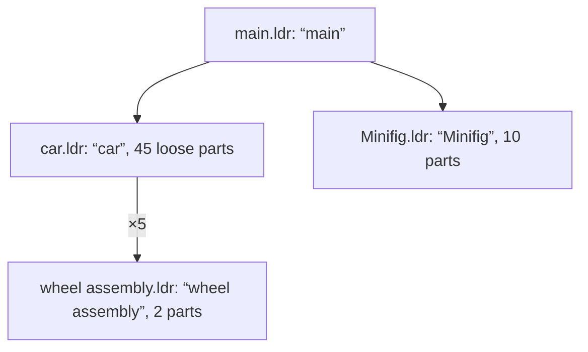
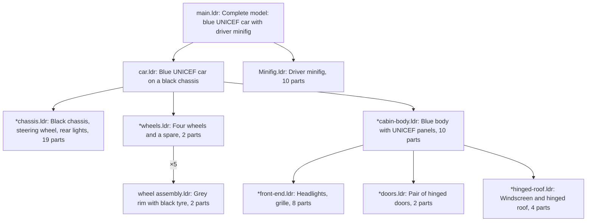

# AGENTS.md — ldraw-annotator-nova

Turns unannotated LDraw models (`.ldr`/`.mpd`, any size) into annotated, self-contained `.mpd`
files: a semantic submodel hierarchy, a description per submodel, a `0 //` comment per part.
The format of the result is specified in [docs/output-contract.md](docs/output-contract.md).

## What it achieves

Example: `tests/fixtures/106-1.mpd`, from a real run.

Input: names only (`0 car`), and the whole car is one flat list of 45 parts.



Output: the same 45 parts regrouped into named assemblies, one description per submodel, and a
`0 // <part> (<colour>)` comment per part. `*` marks new submodels.



What it adds:
- structure: new submodels, each a unit a builder would name. Depth is decided per branch, and a
  section is a leaf when splitting it makes no sense;
- meaning: a description per submodel, kebab-case names, optional `0 !KEYWORDS`;
- part comments.

What it never changes: each part occurrence's world placement and colour. New submodels are
referenced with the identity matrix, so moved part lines stay byte-for-byte the same. `check`
proves this for every output.

## Annotate models (the normal case)

```sh
ldraw-annotator run <files or directories...> --out output/annotated [-j 6]
ldraw-annotator status            # progress, calls, tokens, failures (reads ./work)
```

In this repo, prefix commands with `uv run` (or use `.venv/bin/ldraw-annotator`).

- Every command but `status` needs the LDraw info DB: `--db <path>` or `$LDRAW_ANNOTATOR_DB`. In
  this repo it is `data/ldraw-info.db`.
- `run` is **resumable**. If it's aborted, run the same command again: finished models and
  finished LLM calls are never redone.
- Models that already have an output are skipped. Use `--force` to redo them.
- Exit code 0 means every model is done and verified. 1 means some model failed its check (see
  `status` and `work/<model>/check.json`). 2 means bad input.
- Nothing to install, write or research: the tool calls the LLM itself, checks every answer, and
  verifies every output.
- Models are `provider:model` (`--split-model`, `--refine-model`; default `zai:glm-5.3` and
  `zai:glm-5.3-flash`). Credentials are the provider's env vars (`ZAI_API_KEY`, `ZAI_BASE_URL`,
  `OPENROUTER_API_KEY`, `OLLAMA_HOST`, ...). If calls fail with an auth or missing-key error, ask
  the user to set them (README, "Choosing the LLM"). Never look for, copy or print credentials.

## How it works (so you can debug it)

1. **prep** (no LLM, < 1 s even for 50 MB):
   - split sections and set embedded-part geometry aside;
   - add part comments (`ldraw_annotator/parts.py`);
   - move flexible parts into their own submodels (`ldraw_annotator/flex.py`).
2. **rounds** (LLM, parallel). Every section that needs a decision is shown as a compact digest.
   One single-shot call per unit (`ldraw_annotator/llm.py`, via any-llm) returns, per section:
   - a description;
   - either "leaf" (stop) or new child submodels, one level down.

   New children are decided in the next round. Recursion ends when every branch is a leaf.
3. **refine** (LLM, 1 small call): parent descriptions are rewritten from their children's.
4. **write + check**: the output is written, then verified (lossless, contract rules, pyldraw3
   reparse).

Prompts (shipped in the wheel): `ldraw_annotator/prompts/split.md`,
`ldraw_annotator/prompts/refine.md`, plus the knowledge base
`ldraw_annotator/prompts/annotation-guide.md`.

| Module | Does |
|---|---|
| `cli.py` | commands, `--db`, exit codes |
| `run.py` | batch orchestration, retries, resume, status |
| `llm.py` | one LLM call (any-llm) |
| `mpd.py` | streaming MPD reader/writer, section classification, IR |
| `parts.py` | part comments, the DB path |
| `flex.py` | flexible parts (LSynth, LDCad) |
| `digest.py` | the compact views the LLM reads |
| `plan.py` | answer schemas, validation, applying splits |
| `check.py` | lossless and contract verification |
| `db.py` | db-sync |

## Debugging commands

| Command | Does |
|---|---|
| `ldraw-annotator digest <model file or work name> [--tree]` | print what the LLM sees |
| `ldraw-annotator prep <file>` | prep only; saves `work/<model>/ir.r0.json` |
| `ldraw-annotator apply <model> <plan.json>` | apply a hand-written split plan to the latest IR |
| `ldraw-annotator write <model> <out.mpd>` | write the latest IR |
| `ldraw-annotator check <input> <output>` | verify an output |
| `uv run pytest` | deterministic tests (no LLM; fixtures in `tests/fixtures/`) |

The work files are in `work/<model>/`:

| File | Contents |
|---|---|
| `ir.rN.json` | the IR after round N |
| `units/*.json` | accepted LLM answers |
| `units/*.failed.json` | rejected answers |
| `log.jsonl` | per call: model, time, tokens, errors |
| `check.json` | the verification report |

## Rules

- Never write to the LDraw info DB from an agent (`data/ldraw-info.db` or the one in
  `$LDRAW_ANNOTATOR_DB`). `db-sync` is run by the user.
- Never hand-edit outputs. Change the tool, prompts or guide, then rerun with `--force`.
- `README.md` is for users, this file is for agents: keep each for its audience.
