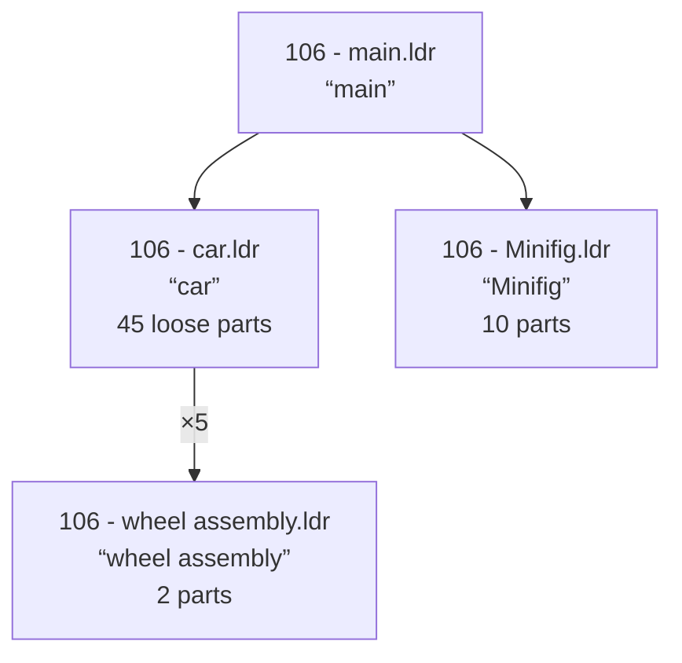
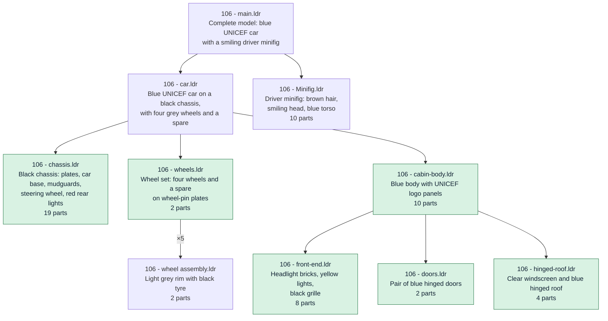

# ldraw-annotator-nova

Turn plain LDraw models (`.ldr` / `.mpd`, from a few parts up to tens of MB) into annotated,
self-contained `.mpd` files. An agent (an LLM) structures the model; the tool checks every
answer and verifies every output.

Each output has:

- a **submodel hierarchy** a builder would recognise (`chassis`, `wheels`, `doors`, `hinged-roof`…),
  as deep as each branch needs;
- a one-line **description** of every submodel;
- a **part comment** above every part: `0 // Plate  2 x  2 (black)`;
- **flexible parts** (hoses, cables, flex axles…) in their own submodels.

## Before and after

Set 106-1, a small UNICEF car (in [tests/fixtures/](tests/fixtures/)), annotated by the tool.

**Before.** Four submodels with names but no real descriptions. Everything that makes the car
(chassis, body, doors, roof, lights) is one flat list of 45 parts in `car.ldr`.



**After.** The same 45 parts are grouped into the assemblies a builder would name. Every
submodel says what it is. The new submodels are highlighted.



Inside each submodel, every part gets a comment naming it and its colour:

```
Before                                   After
0 FILE 106 - car.ldr                     0 FILE 106 - chassis.ldr
0 car                                    0 Black car chassis: long plates and car base with mudguards, …
0 Name: 106 - car.ldr                    0 Name: 106 - chassis.ldr
…                                        …
1 0 0 0 0 1 0 0 0 1 0 0 0 1 3832.dat     0 // Plate  2 x 10 (black)
                                         1 0 0 0 0 1 0 0 0 1 0 0 0 1 3832.dat
```

Nothing is lost: every part, colour, position and step of the input is still there. The exact
format is in [docs/output-contract.md](docs/output-contract.md).

## Install

You need Python 3.12 or newer and [uv](https://docs.astral.sh/uv/) (or `pipx`, or `pip`).
The [latest release](https://github.com/anteloc/ldraw-annotator-nova/releases/latest) shows the
exact install command; for version `X.Y.Z` it is:

```sh
# installs the `ldraw-annotator` command, in its own environment
uv tool install https://github.com/anteloc/ldraw-annotator-nova/releases/download/vX.Y.Z/ldraw_annotator_nova-X.Y.Z-py3-none-any.whl

# or, with pipx
pipx install https://github.com/anteloc/ldraw-annotator-nova/releases/download/vX.Y.Z/ldraw_annotator_nova-X.Y.Z-py3-none-any.whl

ldraw-annotator --help
```

### The parts database

Part and colour names come from `ldraw-info.db`, a SQLite file published next to the wheel on
the [releases page](https://github.com/anteloc/ldraw-annotator-nova/releases). Download it once
and tell the tool where it is:

```sh
mkdir -p ~/.local/share/ldraw-annotator
curl -L -o ~/.local/share/ldraw-annotator/ldraw-info.db \
  https://github.com/anteloc/ldraw-annotator-nova/releases/latest/download/ldraw-info.db

export LDRAW_ANNOTATOR_DB=~/.local/share/ldraw-annotator/ldraw-info.db   # e.g. in ~/.zshrc
```

Or pass it to each command with `--db path/to/ldraw-info.db`.

### An agent

The agent is the LLM that structures your models. The default is [z.ai](https://z.ai) GLM. Set
your key:

```sh
export ZAI_API_KEY=...
# with a GLM Coding Plan key, also:
export ZAI_BASE_URL=https://api.z.ai/api/coding/paas/v4
```

Other providers, and local agents with Ollama, are covered under
[Choosing the agents](#choosing-the-agents).

## Annotate models

```sh
# one model
ldraw-annotator run my-car.mpd --out annotated

# several files and whole directories (searched recursively for .ldr and .mpd)
ldraw-annotator run models/ more-models/ truck.ldr --out annotated

# more calls in parallel (default 4): faster on big batches, if your provider allows it
ldraw-annotator run models/ --out annotated -j 8
```

`run` prints a JSON summary per model and writes `annotated/<model>.mpd`. A model's output is
written only once it has passed verification.

### Resume, redo, watch

All progress is kept in a work directory (`./work` by default; change it with `--work`).

```sh
# aborted (Ctrl-C, crash, network down)? run the same command again: finished models and
# finished agent calls are not redone
ldraw-annotator run models/ --out annotated

# models that already have an output are skipped; --force redoes them
ldraw-annotator run my-car.mpd --out annotated --force

# progress of a batch, from another terminal: state, calls, tokens, failures per model
ldraw-annotator status
ldraw-annotator status --work /path/to/other/work
```

### Exit codes

| Code | Meaning |
|---|---|
| 0 | every model is done and verified |
| 1 | some model failed its verification (see `status` and `work/<model>/check.json`) |
| 2 | bad input: missing file, missing database, bad option |

A model is still "done" when the agent couldn't decide a few sections after 3 attempts: those
sections are left as they were, and listed under `failed_units`.

## Annotate with your own agent

Already working with a coding agent (Claude Code, Codex, Cursor…)? It can be the agent itself,
with no API key: the tool prepares the model, tells the agent what to do, and verifies the
result.

```sh
# 1. the whole model as one .mpd, with part comments and flexible parts done
ldraw-annotator prep my-car.mpd --mpd my-car.annotated.mpd

# 2. the instructions: how to split, describe and name submodels
ldraw-annotator prompt

# 3. once the agent has edited my-car.annotated.mpd: verify it
ldraw-annotator check my-car.mpd my-car.annotated.mpd
```

Point your agent at these three commands, e.g. *"Annotate my-car.mpd: run `ldraw-annotator
prompt` and follow it."* It's done when `check` says `"ok": true`.

## Choosing the agents

There are two jobs, each with its own agent (LLM):

- **split** (`--split-agent`) decides the hierarchy. It's the hard job: use a strong agent.
- **refine** (`--refine-agent`) rewrites parent descriptions from their children's. A small,
  cheap agent is enough.

An agent is written `provider:agent`, with the provider's own name for it. Keys and endpoints come
from each provider's usual environment variables, so they never appear on the command line.

| Provider | Agent example | Environment |
|---|---|---|
| z.ai (default) | `zai:glm-5.3` | `ZAI_API_KEY`, optional `ZAI_BASE_URL` |
| OpenRouter | `openrouter:z-ai/glm-5.3` | `OPENROUTER_API_KEY` |
| OpenAI | `openai:gpt-5.6-sol` | `OPENAI_API_KEY` |
| Anthropic | `anthropic:claude-sonnet-5-5` | `ANTHROPIC_API_KEY` |
| Ollama (local) | `ollama:qwen3:32b` | optional `OLLAMA_HOST` (default `http://localhost:11434`) |

```sh
# defaults: zai:glm-5.3 for split, zai:glm-5.3-flash for refine
ldraw-annotator run models/ --out annotated

# the same agents through OpenRouter
ldraw-annotator run models/ --out annotated \
  --split-agent openrouter:z-ai/glm-5.3 --refine-agent openrouter:z-ai/glm-5.3-flash

# Anthropic: a strong agent for the hierarchy, a small one for descriptions
ldraw-annotator run models/ --out annotated \
  --split-agent anthropic:claude-sonnet-5-5 --refine-agent anthropic:claude-haiku-5-5
```

To avoid typing them every time, set your choice once:

```sh
export LDRAW_ANNOTATOR_SPLIT_AGENT=openrouter:z-ai/glm-5.3
export LDRAW_ANNOTATOR_REFINE_AGENT=openrouter:z-ai/glm-5.3-flash
```

### Local agents with Ollama

No key and no cost; your models never leave your machine.

```sh
ollama serve                 # if it isn't running already
ollama pull qwen3:32b
ollama pull qwen3:8b

ldraw-annotator run my-car.mpd --out annotated \
  --split-agent ollama:qwen3:32b --refine-agent ollama:qwen3:8b -j 1

# Ollama on another machine
OLLAMA_HOST=http://gpu-box:11434 ldraw-annotator run my-car.mpd --out annotated \
  --split-agent ollama:qwen3:32b --refine-agent ollama:qwen3:8b
```

- Keep `-j` low (1-2): a local server answers one call at a time anyway.
- Small agents often break the answer rules. Their sections are retried, then left unsplit and
  listed under `failed_units`. If `status` shows many, use a bigger agent for `--split-agent`.
- Mixing works well: a cloud agent for split, a local one for refine:

  ```sh
  ldraw-annotator run models/ --out annotated --split-agent zai:glm-5.3 --refine-agent ollama:qwen3:8b
  ```

### Other providers

The calls go through [any-llm](https://github.com/mozilla-ai/any-llm), which supports many more
providers: Mistral, Gemini, Groq, Bedrock, LM Studio, llama.cpp and others. Some need their SDK
installed alongside the tool:

```sh
uv tool install --with 'any-llm-sdk[mistral]' <wheel url>
ldraw-annotator run models/ --out annotated --split-agent mistral:mistral-large-latest
```

### Reasoning effort

`--thinking` (`none`, `low`, `medium`, `high`, `xhigh`; default `low`) sets how long reasoning
agents think. `low` is the fastest setting that still answers well; with GLM, the provider's
default reasoning made calls about 10x slower.

## Other commands

```sh
# verify an annotated file against its input: lossless, format rules, pyldraw3 reparse
ldraw-annotator check my-car.mpd annotated/my-car.mpd

# see what the agent is shown for a model (before or during a run)
ldraw-annotator digest my-car.mpd
ldraw-annotator digest my-car --tree        # the hierarchy so far, from the work directory

# prepare a model without any agent: part comments + flexible parts, saved as work/<model>/ir.r0.json
ldraw-annotator prep my-car.mpd
ldraw-annotator prep my-car.mpd --mpd prepped.mpd   # the same, as one .mpd file instead
```

Every command prints JSON (except `prompt`, which prints Markdown), so results are easy to script:

```sh
ldraw-annotator status | jq '.[] | select(.state != "done") | .model'
```

## Store results in the database

`db-sync` writes annotated models into the database, for search and reuse:

```sh
ldraw-annotator db-sync annotated/
```

It upserts `MODELS_DESCRIPTIONS` and `SUBMODELS_DESCRIPTIONS`, plus `SUBMODELS_REFERENCES(model,
parent, child, count)` (created on first use). The full-text search tables follow through their
triggers. It's the only command that writes to the database, so keep a copy if you care about it.

## Development

```sh
git clone https://github.com/anteloc/ldraw-annotator-nova && cd ldraw-annotator-nova
uv sync --extra test              # .venv with the package installed in editable mode
uv run ldraw-annotator --help
uv run pytest                     # deterministic tests, no agent; uses data/ldraw-info.db
uv build --wheel                  # dist/ldraw_annotator_nova-<version>-py3-none-any.whl
```

To publish a release, tag a commit on `master` and push the tag:

```sh
git tag v0.5.0
git push origin v0.5.0
```

The `release` workflow runs the tests, builds the wheel (its version comes from the tag, so there
is nothing to bump), and attaches it and `ldraw-info.db` to the `v0.5.0` release. Tags on commits
that aren't on `master` are refused.

How the pipeline works is described in [AGENTS.md](AGENTS.md).

## License

Code: [AGPL-3.0](LICENSE). Documentation and prompts: [CC BY-SA 4.0](CC-BY-SA-4.0).

## Acknowledgements

I'd like to thank the following:

- [The LDraw Community](https://www.ldraw.org/)
- [LDView](https://tcobbs.github.io/ldview/)'s Travis Cobbs (@tcobbs), and contributors.
- [LeoCAD](https://github.com/leozide/leocad)'s Leonardo Zide (@leozide), and contributors.
- [LDCad](https://www.melkert.net/LDCad) and Shadow Library, Roland Melkert.
- [pyldraw3](https://github.com/hbmartin/pyldraw3)'s  Harold Martin (@hbmartin), and contributors.

... and thanks to all of the many other LDraw creators!

**NOTE:** For this work, I've used many LDraw models, libraries, tools, docs... from many sources.

There is a lot **amazing people** that generously contributed to this, even for **decades**, by **generously donating their finest work** to the public domain and open source community. 

If you think you should be included on this section, please **drop me an email!**

## Trademarks

**LEGO(R)** is a trademark of the **LEGO Group** of companies which does not sponsor, authorize or endorse this software.

